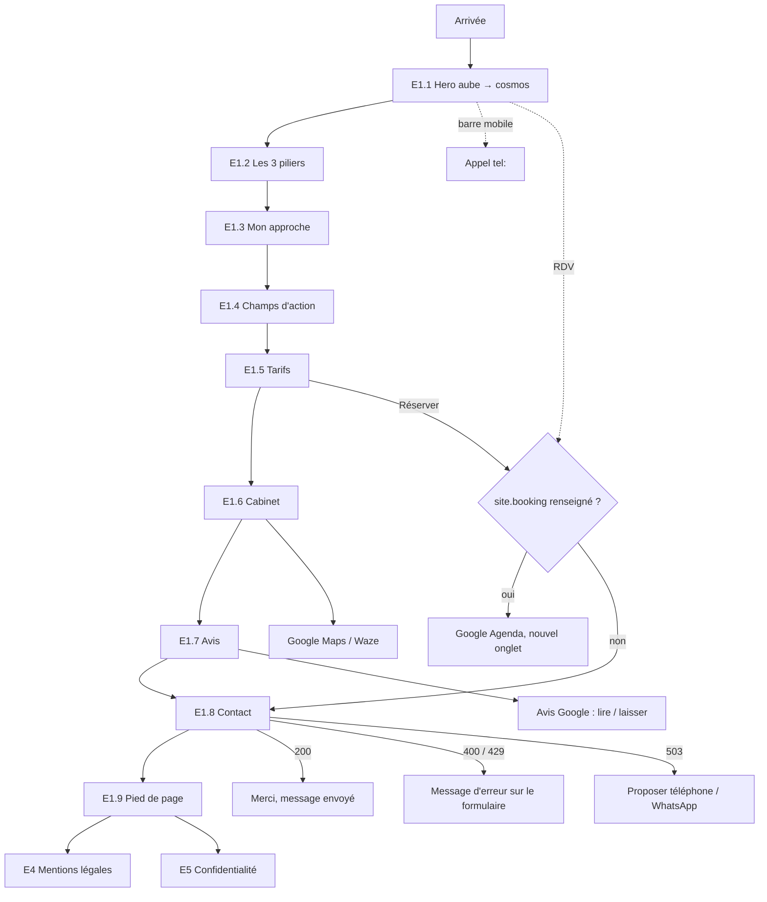

# 03 — App flow : écrans et parcours

Site one-page + pages légales. Les « écrans » de l'accueil sont des sections reliées par des ancres.

## Écrans
| # | Écran / section | But | Données affichées | Actions | États |
|---|---|---|---|---|---|
| E1 | En-tête fixe | Naviguer, contacter | Logo, liens d'ancre, réseaux, « Prendre rendez-vous » | Ancres, réseaux (nouvel onglet), RDV, burger (mobile) | Transparent → plein au défilement ; menu ouvert / fermé |
| E1.1 | Hero « aube → cosmos » | Comprendre l'approche | H1, sous-titres, baseline, 3 piliers, mots-clés, phrase manuscrite, visuel | Défiler ; clic pilier → section E1.2 {{à confirmer}} | Chargement (visuel flou → net) ; vidéo prête (si F7) ; mouvement réduit (statique) |
| E1.2 | Les 3 piliers (nouveau, remplace « Les outils ») | Détailler chaque pilier et ses outils | Par pilier : icône, titre, résumé, outils (nom + texte) | Aucune (lecture) | Apparition au défilement |
| E1.3 | Mon approche | Présenter Nawal | Texte, citation, signature, portrait ou emplacement réservé | — | Portrait présent / « Photo à venir » |
| E1.4 | Champs d'action | Pour quoi consulter | 4 rangées existantes (+ bienfaits du hero actuel ? {{à confirmer}}) | — | — |
| E1.5 | Tarifs | Prix | Séances, « Bon à savoir » | « Réserver une séance » | — |
| E1.6 | Le cabinet | Venir | Photo, adresse, horaires, téléphone, stationnement | Google Maps, Waze, appel | — |
| E1.7 | Avis | Rassurer | Note, nombre d'avis, carrousel | « Lire tous les avis », « Laisser un avis » (Google) | — |
| E1.8 | Contact | Écrire | Formulaire, téléphone, WhatsApp | Envoyer | Saisie ; envoi ; succès ; erreur de champ (400) ; trop d'envois (429) ; service indisponible (503 → téléphone/WhatsApp) |
| E1.9 | Pied de page | Coordonnées, confiance | Cabinet, horaires, réseaux, logos SSP/SDMH, avertissement médical | Liens légaux, Maps, Waze | — |
| E2 | Menu mobile | Naviguer sur mobile | Liens, RDV, téléphone | Lien → ferme le menu | Ouvert / fermé (Échap) |
| E3 | Barre mobile | Agir vite | « Appeler », « Prendre rendez-vous » | Appel, RDV | Masquée sur le hero, visible ensuite |
| E4 | Mentions légales | Obligation | Éditeur EI, SIREN, hébergeur, médiation | — | — |
| E5 | Confidentialité | RGPD | Formulaire, services tiers, droits | — | — |
| E6 | 404 | Erreur | Message, retour accueil | Retour | — |
| (F12) | Pages piliers | Référencement | Contenu propre à chaque pilier | Contact | Option Could |

Liens externes : Google Agenda (si `site.booking`), Google Maps, Waze, fiche et avis Google, Instagram, Facebook, LinkedIn, WhatsApp, `tel:`.

## Parcours

