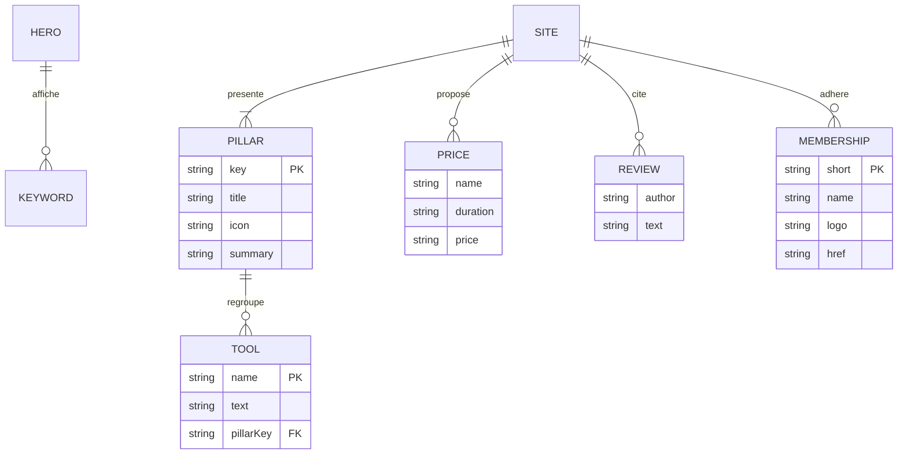

# 05 — Données

## Pas de base de données
Le site ne stocke rien : le contenu est versionné dans `lib/site.ts` et le formulaire envoie un e-mail sans rien conserver côté serveur. Aucun script SQL n'est donc nécessaire. Une base ne deviendrait utile qu'avec un CMS, une prise de rendez-vous intégrée ou un espace client, tous hors périmètre (doc 01).

## Modèle de contenu (`lib/site.ts`)
Ajouts et changements proposés ; les textes viennent de la référence et de l'existant, à valider {{à confirmer}}.

```ts
export type PillarKey = 'psycho' | 'energie' | 'quantique';

export const hero = {
  title: 'Thérapies',
  subtitle: ['Psycho Corporelle', 'Énergétique', 'et Quantique'],
  baseline: 'Reconnecter votre corps, vos émotions et votre énergie à votre potentiel',
  script: 'Une approche globale, créative et sur mesure',
  keywords: ['Corps', 'Énergie', 'Conscience', 'Équilibre', 'Liberté']
};

export const pillars: {
  key: PillarKey;
  title: string;      // « Psycho corporelle »
  icon: 'body' | 'lotus' | 'atom';
  summary: string;    // texte court du hero
  tools: string[];    // noms d'outils pris dans toolGroups (répartition à valider)
}[] = [/* 3 entrées */];
```
- `toolGroups` (existant) est remplacé par `pillars[].tools` relié aux fiches d'outils existantes (nom + texte), sans dupliquer les textes.
- `benefits` (5 bienfaits du hero actuel) : déplacé vers « Champs d'action » ou supprimé {{à confirmer}}.
- Inchangés : `site`, `links`, `socials`, `prices`, `rating`, `reviews`, `legal`, `memberships`.



## API (existante, inchangée)
`POST /api/contact`, corps JSON :
| Champ | Type | Règle |
|---|---|---|
| `name` | string | 2–120 caractères |
| `email` | string | format e-mail, ≤ 200 |
| `phone` | string | facultatif, ≤ 40 |
| `message` | string | 10–5000 caractères |
| `consent` | boolean | `true` obligatoire |
| `company` | string | piège à robots, doit rester vide |
Réponses : 200 (envoyé), 400 (champ invalide), 429 (5 envois par IP sur 10 min), 502 (échec Resend), 503 (clé ou destinataire manquant).

## Règles d'accès
| Donnée | Lecture | Écriture |
|---|---|---|
| Contenu (`lib/site.ts`, images) | Public | Développeur, par commit Git sur la branche |
| Messages du formulaire | Destinataire de l'e-mail uniquement | Visiteur (envoi), rien n'est conservé sur le serveur |
| Secrets (Resend, VPS) | Workflow GitHub Actions et conteneur | Propriétaire du dépôt (secrets GitHub) |
